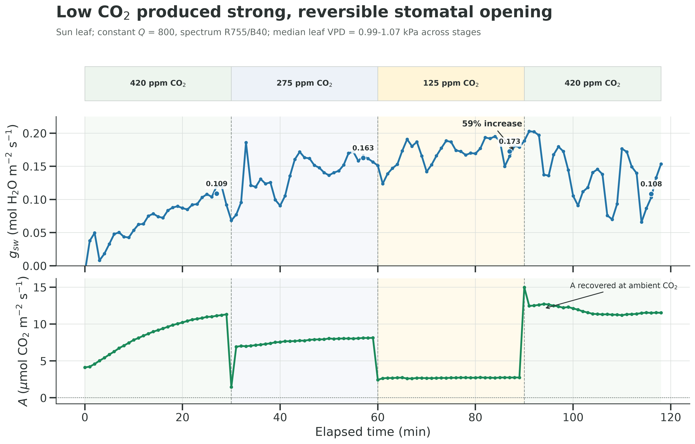

# Forcing Plants to Participate

**If a leaf isn't photosynthesizing, how can we tell if it's incapable or unwilling?**

Riley Leff, Acadia Conboy, and Keryn Gedan

This repository contains our LI-6800 background programs, original gas-exchange
and fluorescence data, analyses, and figures from coastal Virginia. We used low
CO2 to encourage stomatal opening, then measured CO2 response ramps at multiple
light levels to investigate photosynthetic capacity. The final Phragmites pilot
compares leaves from the high and low ends of a forest-marsh elevation gradient.

[Read the story](https://rileyleff.com/blog/forcing-plants-to-participate).
Supported for open release by the Astera Institute Hidden Science Competition.

**Status:** release preparation, October 2026. Programs were used in this research;
this is not a manufacturer-certified protocol. No DOI has been assigned to this
release yet. The data are included here; a future Zenodo archive will be a mirror.

## Find what you need

| I want to... | Start here |
| --- | --- |
| Run the instrument protocol | [Current program and setup](bp/README.md) |
| Inspect original observations | [Data guide](docs/DATA.md), [run index](data/run_index.csv), [raw files](data/) |
| Understand exclusions and limitations | [Data/QC guide](docs/DATA.md), [limitations](docs/LIMITATIONS.md) |
| Read the existing findings | [Three-tier report](outputs/phrag_brownsville_three_tier_analysis.md), [results index](outputs/README.md) |
| Reproduce the analyses | [Reproduction instructions](docs/REPRODUCING.md), [script index](scripts/README.md) |
| See how the method developed | [Historical programs](bp/README.md), [earlier runs](data/run_index.csv) |
| Cite or reuse this work | [Citation](CITATION.cff), [licensing](LICENSE-DATA.md), [references](docs/REFERENCES.md) |



## Get the complete repository

```sh
git lfs install
git clone https://github.com/RileyLeff/photo26.git
cd photo26
git lfs pull
uv sync --frozen
uv run --frozen python -m unittest discover -s tests -v
uv run --frozen python scripts/release_manifest.py --check
```

All raw logs, original flash ZIPs, extracted JSON/XLSX events, metadata, and
scientific results are included. Only the approximately 182 MiB generated
`outputs/phrag_brownsville_cohort_points.csv` uses Git LFS. All raw data and other
scientific outputs use ordinary Git. GitHub archive downloads may contain an LFS
pointer unless inclusion of LFS objects is enabled; cloning with LFS is safest.
Without LFS, regenerate that table with the cohort stage below.

Python 3.13.7 is recorded in `.python-version`; `uv.lock` pins the environment.
For posterior summaries or Bayesian fitting, use `uv sync --frozen --extra bayes`.
PhoTorch and XY experiments have separate `photorch` and `xy` extras.

```sh
# Print the ordered workflow without running or overwriting anything:
uv run --frozen python scripts/reproduce.py

# Regenerate the cohort tables and figures (overwrites matching outputs):
uv run --frozen python scripts/reproduce.py --stage cohort --execute
```

## What the data support

The final cohort contains 15 runs; 12 are retained for some analyses, including
four shade pilots. The primary sun-leaf gas comparison is **three high-elevation
versus five low-elevation leaves**, not twelve independent treatment replicates.
P02 is excluded from fluorescence analyses, leaving three versus four leaves.
The retained set has 62,326 raw gas observations and 665 flash JSON records.

High/Low labels mean **elevation**. The lower elevation is the more saline, more
open habitat; these data do not isolate salinity from light and other site effects.
We found wide, overlapping modeled capacity estimates. That is an unresolved
contrast in a small sample, not proof of equivalent capacities. Fluorescence adds
information about energy partitioning but does not independently identify gm.

## Repository boundaries

Paths are preserved so the existing analysis works: `bp/` for instrument programs,
`data/` for originals, `src/` for shared Python, `scripts/` for analyses, `outputs/`
for saved scientific results, `docs/` for explanations, and `tests/` for regression
checks. Excluded raw runs remain available with QC reasons.

Temporary render files, downloaded manuals/papers, commercial fonts, and poster
branding assets are not redistributed. Historical presentation scripts remain
for provenance but require external assets; see [third-party notes](THIRD_PARTY.md).

Code is MIT-licensed. Research data, original figures, and documentation are
CC BY 4.0. See the scoped notices in [LICENSE](LICENSE) and
[LICENSE-DATA.md](LICENSE-DATA.md). A reproducibility check does not establish
instrument compatibility or validate a biological interpretation.
